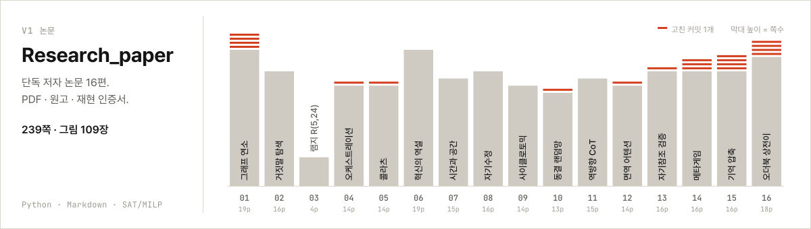
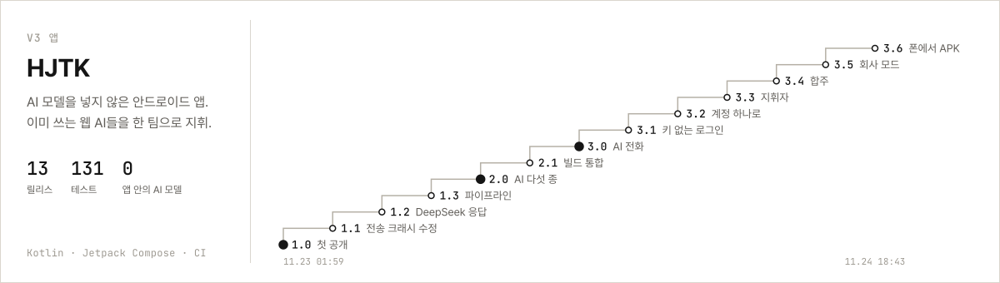
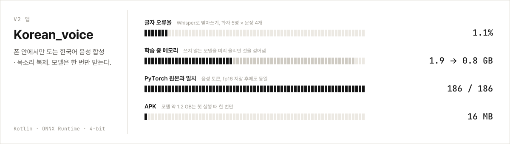
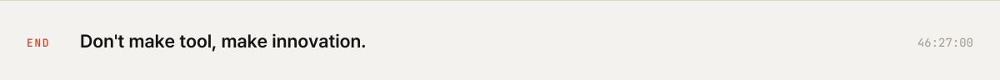

<picture>
  <source media="(prefers-color-scheme: dark)" srcset="assets/timeline-dark.svg">
  
</picture>

학생입니다.

위 그림은 이 계정에 올린 것을 커밋한 시각 그대로 편집 타임라인에 놓은 것입니다. 클립 하나가 릴리스나 논문 하나이고, 맨 아래 A1 트랙의 주황색 표시는 무언가를 **고친** 커밋입니다.

 

## 작업

<a href="https://github.com/heok0308hth-glitch/Research_paper">
  <picture>
    <source media="(prefers-color-scheme: dark)" srcset="assets/papers-dark.svg">
    
  </picture>
</a>

**[Research_paper](https://github.com/heok0308hth-glitch/Research_paper)** · 단독 저자 논문 16편. 그래프 연소, 램지 하한 R(5,24) ≥ 565, 거짓말이 섞인 탐색, 일반화 콜라츠, 다중 에이전트 검증, 오더북 상전이까지. 논문마다 PDF와 원고가 있고, 램지 논문에는 직접 다시 돌려 볼 수 있는 인증서가 붙어 있습니다.

 

<a href="https://github.com/heok0308hth-glitch/HJTK">
  <picture>
    <source media="(prefers-color-scheme: dark)" srcset="assets/hjtk-dark.svg">
    
  </picture>
</a>

**[HJTK](https://github.com/heok0308hth-glitch/HJTK)** · AI 모델을 하나도 넣지 않은 안드로이드 앱. 폰에서 이미 로그인해 쓰는 Claude · ChatGPT · Gemini · Grok · DeepSeek에 일을 나눠 맡기고, 밖으로 나가는 동작은 한 번 눌러야만 실행됩니다.

 

<a href="https://github.com/heok0308hth-glitch/Korean_voice">
  <picture>
    <source media="(prefers-color-scheme: dark)" srcset="assets/voice-dark.svg">
    
  </picture>
</a>

**[Korean_voice](https://github.com/heok0308hth-glitch/Korean_voice)** · 폰 안에서만 도는 한국어 음성 합성과 목소리 복제. 약 5억 파라미터 모델을 ONNX로 옮기고 4비트로 줄였고, 모델을 한 번 받은 뒤에는 인터넷 없이 동작합니다.

 

## 고친 기록

틀린 건 지우지 않고 고친 커밋으로 남깁니다. 위 타임라인의 주황색 중 몇 개입니다.

| 시각 | 어디 | 무엇이 틀렸고, 어떻게 고쳤나 |
|---|---|---|
| 11.24 22:13 | 논문 5 · 13 · 15 · 16 | 그림·표 번호가 읽는 순서와 달랐다. 논문 13 표 6의 근사값 네 칸을 다시 계산했고, 논문 16 초록의 "4.9배"를 본문 표대로 4.8배로 바꿨다 |
| 11.24 21:16 | Korean_voice | 소스와 모델이 있던 저장소가 지워져 새로 설치하면 모델을 받을 수 없었다. 남은 APK를 디컴파일해 모델 13개를 다시 만들고 v2.1.4로 복구 |
| 11.24 08:44 | 논문 16 | 5절의 실행 횟수를 스크립트가 실제로 돌리는 7,962회에 맞춤 |
| 11.24 00:36 | 논문 15 | 초록의 수치를 측정값(참 0.45–1.33%, 거짓 96.2–98.1%)으로 고침 |
| 11.24 00:21 | 논문 12 | 곳곳에서 조금씩 달랐던 R0 정의를 하나로 통일 |
| 11.24 00:08 | 논문 14 | 초록의 분모를 앙상블 표에 맞춤(3,995건 중 1,091건) |
| 11.23 01:33 | HJTK | 앱이 죽어도 작업이 이어지게 하고, 작업 기록 파일이 깨지면 스스로 복구하게 하고, Android 15 포그라운드 서비스를 정리 |
| 11.23 00:24 | 논문 4 | 영문 초록의 반례 수치를 본문 표(0.943 / 0.763)에 맞춤 |

나머지는 각 저장소의 커밋 기록에 있습니다.

 

## 연락

어느 저장소든 이슈나 PR이 가장 빠릅니다. 논문에 대한 반례나 오류 제보를 가장 반깁니다.

 

<picture>
  <source media="(prefers-color-scheme: dark)" srcset="assets/end-dark.svg">
  
</picture>

그림은 모두 네 저장소의 git 기록에서 그렸습니다. 다시 그리는 스크립트는 <a href="tools/">tools/</a>에 있습니다.
